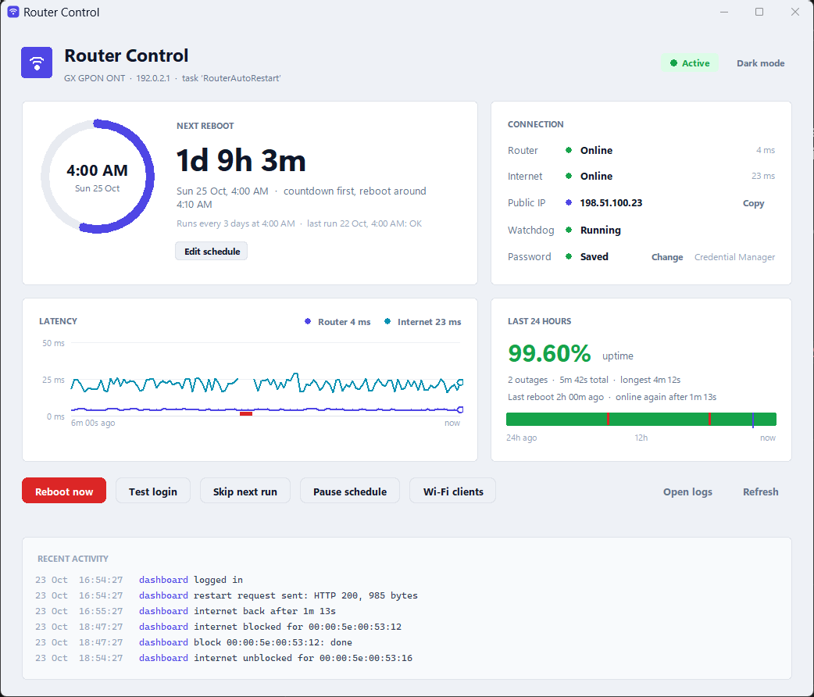
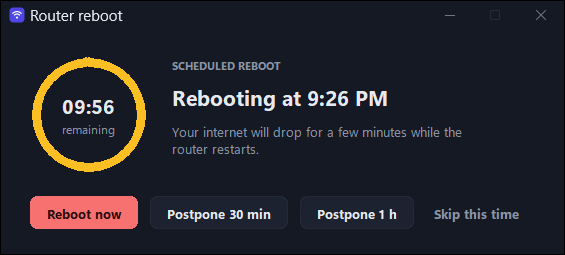
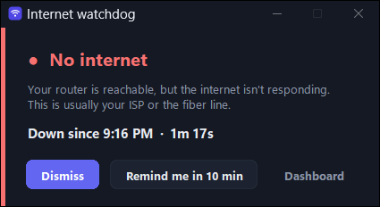
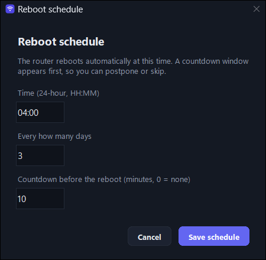

# windows-router-auto-restart

Scheduled restarts for home routers that can't restart themselves on a schedule, driven from a
Windows PC. It includes a countdown window that lets you postpone or skip a restart, an internet
watchdog, a dashboard and, since 2.2.0, an Android companion app.

<picture>
  <source media="(prefers-color-scheme: dark)" srcset="docs/images/dashboard-dark.png">
  
</picture>

> **Router support is narrow on purpose.** Each router model logs in differently, so every model
> needs its own adapter. Only one model has been verified so far (see [Compatibility](#router-compatibility)).
> The project never guesses web-interface endpoints.

## Why

Some ISP-supplied routers and ONTs slow down or drop connections after running for days, and their
firmware has no "restart every N days" option. This project logs in to the router's own web
interface, exactly as you would in a browser, and presses its restart button for you on a schedule.

## What it does

- **Restarts the router every 3 days** (configurable) at a time you choose, using Windows Task Scheduler.
- **Countdown window** before each scheduled restart: *Restart now*, *Postpone 30 min / 1 h*, or *Skip this time*.
- **Recovery check:** after the restart request it watches the router go offline and come back, waits
  for the internet, and logs the timings. "Request sent" and "service recovered" are reported separately.
- **Safety:** the restart request is sent once and never retried. A second restart is refused while
  one is running or within a cooldown (default 10 min). Login retries are bounded (default 3).
- **Dashboard:** next restart countdown, router and internet status, latency chart, 24-hour uptime,
  activity log, and buttons to restart, test the login, skip the next run, pause, or edit the schedule.
- **Watchdog (optional):** pops up when the router answers but the internet is down, and records outages.
- **Credentials** are stored in Windows Credential Manager. They never go in files, logs, task arguments or URLs.
- **Android companion app (optional, new in 2.2.0):** alerts on your phone when the router is up but
  the internet is down, and restarts the router with one tap. See [Android companion app](#android-companion-app).

## Screenshots

| Countdown before a scheduled restart | Watchdog alert |
|---|---|
|  |  |
| **Editing the schedule** | **Light theme** |
|  |  |

*The screenshots use sample data and documentation addresses (192.0.2.1, 198.51.100.23).*

**Limitations:** Windows 10/11 only. One verified router model. The scheduled task runs only while
you're logged on, because the countdown appears on your desktop. If the PC is off or asleep at the
scheduled time, the task runs at the next opportunity.

## Android companion app

Version 2.2.0 adds a companion app for Android 8.0 and later. It appears on the phone as
**Router Auto Restart**. While your phone is on your home Wi-Fi, it checks every few minutes whether
the router answers but the internet doesn't. When that happens you get a notification with a
**Reboot router** button. The app also has a single restart button.

- Works on its own. The Windows app doesn't need to be running.
- Same login protocol and restart safety rules as the Windows app: the restart is sent once, never
  retried, and refused for 10 minutes after one was sent.
- The password is encrypted with a key in the Android Keystore. No telemetry, no third-party libraries.

| Main screen | Outage alert | Internet back |
|---|---|---|
| <picture><source media="(prefers-color-scheme: dark)" srcset="docs/images/android-main-dark.png"></picture> |  |  |

*Android screenshots are from a real phone, with the status bar cropped out. The alert was triggered
with the app's Simulate an outage switch.*

Download `router-auto-restart-<version>.apk` from the project's
[Releases](https://github.com/svrsunny/windows-router-auto-restart/releases).
Setup, how it works, permissions and building from source are in [docs/android.md](docs/android.md).

## Router compatibility

| `router_model` | Device | Firmware | Status |
|---|---|---|---|
| `gx-gpon-e4222` | GX GPON ONT (web UI with captcha and `postSecurityFlag` checksum) | E4222-3.0.5-R | Verified on one device: login, dry run, restart, recovery |

Other routers need an adapter. See [docs/router-compatibility.md](docs/router-compatibility.md).

## Requirements

- Windows 10 or 11, Windows PowerShell 5.1 (built in) or PowerShell 7
- Python 3.9 or later (developed and tested with 3.12). The only package is `requests`, installed by `Install.ps1`.
- Git, to clone the repository
- `curl` isn't used: all HTTP goes through Python's `requests`

Check what you have:

```powershell
$PSVersionTable.PSVersion
py -3 --version
git --version
```

Missing something? `winget install Python.Python.3.12` and `winget install Git.Git`.

## Install

All commands are run in a **PowerShell** window unless stated otherwise.

```powershell
git clone https://github.com/svrsunny/windows-router-auto-restart.git
Set-Location .\windows-router-auto-restart
Set-ExecutionPolicy -Scope Process -ExecutionPolicy Bypass    # lets this window run the scripts; nothing permanent
.\scripts\Install.ps1
```

`Install.ps1` checks the prerequisites and creates a private Python environment in `.venv`.
It changes nothing outside the folder.

## Configure

```powershell
.\scripts\Configure.ps1
```

It asks for:

- **Router model:** pick from the supported list.
- **Router address:** the IP you open in a browser to manage it, e.g. `192.0.2.1`. Often `192.168.1.1` or `192.168.0.1`.
- **http or https, and port:** usually http on the default port.
- **Admin username.**
- **Restart time:** 24-hour local time, e.g. `04:00`.
- **Interval:** days between restarts, default `3`.
- **Countdown length:** minutes, default `10`, or `0` for none.
- **Password:** typed hidden and stored in Windows Credential Manager.

Settings are saved to `config\config.json`, which is git-ignored and contains no password. See
[docs/configuration.md](docs/configuration.md) for every option and
[config/config.example.json](config/config.example.json) for an example.

You don't need to change anything in the router's own web interface. You only need its admin
username and password, the same ones you use to log in to it in a browser.

## Test the connection (never restarts)

```powershell
.\scripts\Test-Connection.ps1              # reachability, login page, login + logout, internet, DNS
.\scripts\Test-Connection.ps1 -SkipLogin   # if you're logged in to the router in a browser right now
```

Passing these checks shows the login works. It doesn't prove a restart will. Only a real restart can show that.

## Restart manually

```powershell
.\scripts\Restart-Router.ps1            # asks for confirmation; internet drops for a few minutes
.\scripts\Restart-Router.ps1 -WhatIf    # shows what would happen, does nothing
.\scripts\Restart-Router.ps1 -Force     # no confirmation (unattended use)
```

Recovery usually takes 1 to 3 minutes and depends on your router and ISP.

## Schedule the automatic restart

```powershell
.\scripts\Register-ScheduledTask.ps1 -WhatIf                      # preview, changes nothing
.\scripts\Register-ScheduledTask.ps1                              # uses restart_time / interval_days from config
.\scripts\Register-ScheduledTask.ps1 -Time 04:00 -IntervalDays 3 -WithWatchdog
```

Inspect, test, pause or change it:

```powershell
Get-ScheduledTask -TaskName RouterAutoRestart | Get-ScheduledTaskInfo   # last/next run and result
Start-ScheduledTask -TaskName RouterAutoRestart                         # run now (countdown first)
Disable-ScheduledTask -TaskName RouterAutoRestart                       # pause
Enable-ScheduledTask -TaskName RouterAutoRestart                        # resume
.\scripts\Register-ScheduledTask.ps1 -Time 05:30 -IntervalDays 2        # change time or interval
.\scripts\Remove-ScheduledTask.ps1                                      # remove
```

How the task is set up (user account, sleep, daylight saving, failures) is explained in
[docs/scheduling.md](docs/scheduling.md).

## Dashboard and taskbar

```powershell
.\scripts\New-Shortcut.ps1
```

This creates **Router Auto Restart** in the Start menu and on the desktop. To pin it, open Start,
search *Router Auto Restart*, right-click it and choose **Pin to taskbar**.

A shortcut to a `.py` or `.pyw` file can't be pinned, because Windows only pins programs. This
shortcut targets `.venv\Scripts\pythonw.exe` and shares the dashboard window's taskbar identity,
so the pinned icon and the open window share one button.

## Logs and troubleshooting

- `logs\router-auto-restart.log` is the human-readable activity log. Passwords are never written, and redacted if they ever appear.
- `logs\events.jsonl` is the structured history (restarts, login tests, outages) behind the dashboard's uptime figures.
- `.\.venv\Scripts\python.exe src\routerctl.py status` prints a one-screen summary.

Common problems and exit codes are covered in [docs/troubleshooting.md](docs/troubleshooting.md).

## Uninstall

```powershell
.\scripts\Uninstall.ps1                                          # tasks, running watchdog, shortcuts (asks each time)
.\scripts\Uninstall.ps1 -RemovePassword -RemoveLocalData -RemoveVenv
```

Nothing is deleted without confirmation, and the repository's source files are never touched. Add
`-WhatIf` to preview. Then delete the folder if you want everything gone.

## Security

Credentials are stored in Windows Credential Manager for your Windows account only. HTTPS
certificate checks are never disabled. Nothing is sent anywhere except your router and the
connectivity probes. Details are in [docs/security.md](docs/security.md). To report a problem, see
[SECURITY.md](SECURITY.md).

## Repository layout

```
src/routerctl.py              command line (all scripts call this)
src/RouterControl.pyw         double-click launcher for the dashboard
src/routerkit/                the application
  routers/                    one adapter per router model (+ template.py)
  actions.py                  restart, recovery check, diagnostics, duplicate protection
  scheduler.py                Windows Task Scheduler integration
  credentials.py              Windows Credential Manager access
  ui/                         dashboard, countdown window, watchdog pop-up
scripts/                      PowerShell entry points (Install, Configure, Test, Restart, Register, Remove, Shortcut, Uninstall)
config/config.example.json    example configuration (placeholders only)
docs/                         detailed guides
tests/                        automated tests (simulated router, no real restarts)
tools/make_icon.py            regenerates assets/router-auto-restart.ico
android/                      Android companion app: Gradle project, Java sources and tests
```

## Contributing

Adapters for other routers are welcome, and so are reports of models that already work. See
[CONTRIBUTING.md](CONTRIBUTING.md). Please never paste real passwords, cookies or session tokens
into issues or pull requests.

## License

[MIT](LICENSE)
