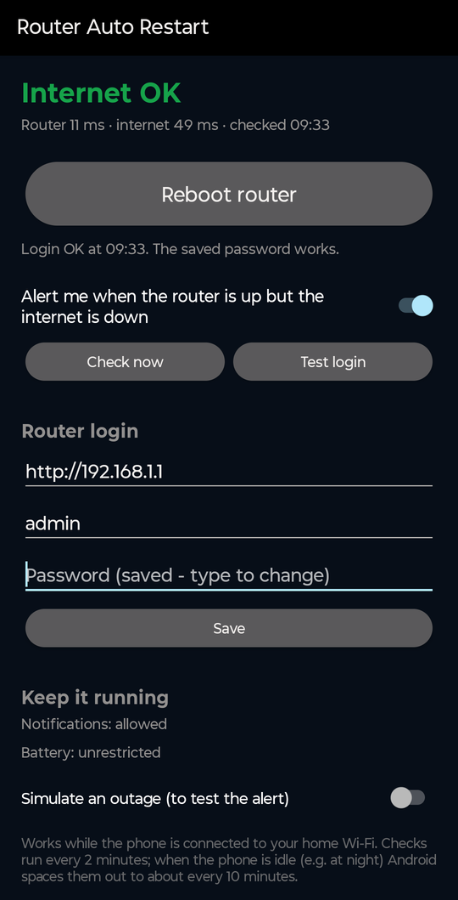
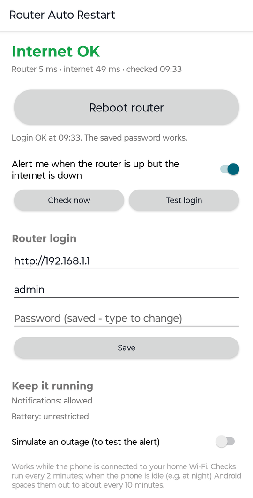
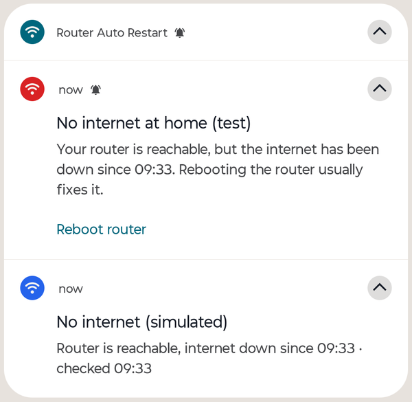
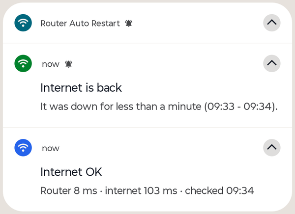

# Android companion app

Since version 2.2.0 the project includes a companion app for Android phones. It appears on the phone
as **Router Auto Restart** and does two things:

1. **Alerts you** when the router answers but the internet doesn't, for example an overnight outage
   that a router restart would fix.
2. **Restarts the router** with one tap: the **Reboot router** button in the app (with a confirmation),
   or the **Reboot router** button on the alert notification.

It works independently of the Windows app: it doesn't need the PC to be on. You can use either one,
or both.

| Main screen (dark / light) | Outage alert | Internet back |
|---|---|---|
|   |  |  |

- [Requirements](#requirements)
- [Install](#install)
- [Set up](#set-up)
- [Test the alert](#test-the-alert)
- [How it works](#how-it-works)
- [Permissions](#permissions)
- [Security and privacy](#security-and-privacy)
- [Limitations](#limitations)
- [Troubleshooting](#troubleshooting)
- [Building from source](#building-from-source)

## Requirements

- Android 8.0 or later.
- The phone must be on the same Wi-Fi network as the router. The app can't see or restart the
  router from outside your home network.
- A supported router. The app supports only the model that's verified for the Windows app:
  `gx-gpon-e4222` (GX GPON ONT, firmware E4222-3.0.5-R). It uses the same login protocol as the
  Windows adapter in [`src/routerkit/routers/gx_gpon.py`](../src/routerkit/routers/gx_gpon.py).

## Install

The app isn't on Google Play. Install the APK from the repository's
[Releases](https://github.com/svrsunny/windows-router-auto-restart/releases) page:

1. On the phone, open the latest release and download `router-auto-restart-<version>.apk`.
2. Open the downloaded file. Android asks you to allow installs from the app you downloaded it with
   (Chrome, Files, Drive); allow it for that app.
3. If Google Play Protect warns about an app from an unknown developer, choose **More details** then
   **Install anyway**.

Every release is signed with the same key, so later versions install over the earlier one and keep
your settings. Its certificate SHA-256 fingerprint is:

```
37c5c61612e487f5f0f8a070ed76c14e2b4a23ec9dbae43261eb5bae5ce4a8b8
```

To check a download on a PC: `apksigner verify --print-certs router-auto-restart-<version>.apk`
(from the Android SDK build-tools) prints it as `Signer #1 certificate SHA-256 digest`.

## Set up

Open **Router Auto Restart** on the phone and:

1. **Allow notifications** when Android asks. Without them there are no alerts.
2. Under **Router login**, enter:
   - **Router address**, e.g. `192.0.2.1` (often `192.168.1.1`). `http://` is added for you.
   - **Username**, usually `admin`.
   - **Password**: the router's admin password, the one you use in a browser.

   Tap **Save**, then **Test login**. The status line under the reboot button should say *Login OK*.
   Test login logs in and out without restarting anything.
3. Turn on **Alert me when the router is up but the internet is down**. A silent notification
   appears in the shade and shows the latest check. It has to stay there: it's what lets Android
   keep the checks running.
4. Tap **Allow unrestricted battery use** and accept. Some phone makers stop background apps even then:
   - Samsung: *Settings > Battery > Background usage limits > Never sleeping apps*, add Router Auto Restart.
   - Xiaomi, Redmi, POCO: *App info > Autostart* on, and *Battery saver > No restrictions*.
   - Others: search the phone's settings for "battery optimization" or see [dontkillmyapp.com](https://dontkillmyapp.com).

If you want alerts to sound during Do Not Disturb, allow the **Internet outage alerts** notification
category to override it in the app's notification settings.

## Test the alert

Turn on **Simulate an outage** at the bottom of the app. Within about 15 seconds you get a
*No internet at home (test)* alert. Turn the switch off and you get *Internet is back*.

> The **Reboot router** button on the test alert is real: it restarts the router.

## How it works

**Checks.** Every 2 minutes the app opens a TCP connection to the router and to `1.1.1.1`,
`8.8.8.8` and `9.9.9.9` on port 443, the same probe targets as the Windows app. It closes each one
straight away. The internet counts as up if any of the three answers. No data is sent.

**Over Wi-Fi only.** All checks and the login go out over the Wi-Fi network explicitly. When Wi-Fi has
no internet, Android quietly moves ordinary app traffic to mobile data. Without this, the outage
would look like working internet and the router would look unreachable.

**When it alerts.** Only when the phone is on Wi-Fi, the router answers and none of the internet
targets do. Before alerting it checks twice more, 5 seconds apart, so a blip doesn't trigger an alert.
It stays quiet:

- for 5 minutes after a restart sent from the app;
- for 5 minutes after the router itself was unreachable (it was restarting or lost power), because
  fiber links need a few minutes to come back.

You get one alert per outage. When the internet returns you get *Internet is back* with how long it
was down.

**Timing.** While the phone is in use, checks run every 2 minutes. When it's idle, for example on a
desk overnight, Android's Doze mode spaces them out to about every 10 minutes. An overnight outage
is typically reported within 10 to 15 minutes.

**Restart from the alert.** *Reboot router* logs in and sends the restart request. The alert
changes to *Router is rebooting*. Then either *Internet is back* arrives, or a new alert if the restart
didn't help.

**Restart safety**, matching the Windows app:

- The restart request is sent once and never retried, even if the connection drops.
- A second restart is refused for 10 minutes after one was sent.
- Login attempts are limited to 3. An *admin session already open* answer is never retried. The
  router allows one admin session at a time, so close the router page in your browser, or wait for
  the Windows app to finish, and try again.

**Away from home.** When the phone leaves Wi-Fi, checks pause. An alert for an outage you left behind
is withdrawn after 15 minutes away.

**After a phone restart** the checks start again by themselves if the alert switch is on.

## Permissions

| Permission | Why |
|---|---|
| Internet, network state | Reach the router and the probe targets, and find the Wi-Fi network |
| Notifications | Show alerts and restart results (Android 13+ asks you) |
| Foreground service (special use) | Keep the checks running, with the silent notification |
| Run at startup | Restart the checks after the phone restarts, if alerts are on |
| Prevent sleep (wake lock) | Stay awake for the few seconds a check or restart takes |
| Exact alarms | Wake up on time for the next check |
| Ignore battery optimizations | Lets you exempt the app with one tap (you confirm it) |

The app doesn't ask for location, storage, contacts or accounts.

## Security and privacy

- **Password.** It's stored on the phone only, encrypted with AES-GCM under a key held in the Android
  Keystore, which can't be extracted from the device. It's sent only to the router, inside the
  router's own login form. It's never logged or shown. Android backup is disabled for the app, so it
  isn't copied to the cloud.
- **Router address.** There's no built-in address. Addresses containing `user:password@` are refused.
- **Plain HTTP on your LAN.** The app allows unencrypted HTTP so it can reach routers whose web page
  is `http://`. The login then travels unencrypted on your local network, as it does from a browser.
  If the router uses `https://`, certificates are verified normally and there is no way to turn that off.
- **Network.** The app talks only to your router and to the three probe addresses above. There's no
  telemetry, no analytics, no ads and no update check.
- **Code.** Plain Java with no third-party libraries. The source is in [`android/`](../android).

## Limitations

- One router model (see [Requirements](#requirements)).
- No checks while the phone isn't on Wi-Fi. Some phones disconnect from a Wi-Fi network that has no
  internet. If yours does, look for a setting such as "Switch to mobile data" or "Intelligent Wi-Fi"
  and turn it off, so the phone stays on Wi-Fi.
- The app recognizes your router only by its address. On another Wi-Fi network where something answers
  at the same address, an outage there can also trigger an alert. A restart from there fails at the
  login unless the password happens to be the same.
- Checks are delayed while the phone is idle (see [Timing](#how-it-works)).

## Troubleshooting

| Message | What to do |
|---|---|
| *The router rejected the login* | Check the username and password, then **Save** and **Test login** again. |
| *The router already has an admin session open* | Log out of the router page in your browser, or wait for the Windows app to finish, then retry. |
| *Can't reach the router* | Is the phone on your home Wi-Fi? Is the router address right? |
| *The router's login page looks different than expected* | Wrong address, or not a supported router or firmware. |
| *The phone isn't on Wi-Fi* | Connect to your home Wi-Fi first. |
| *A reboot was already sent at ...* | The 10-minute cooldown is running. Wait until the time shown. |
| No alerts at all | Check notifications are allowed, battery use is *Unrestricted*, and the silent status notification is present. |

## Building from source

The APK is built without Android Studio or Gradle, on Linux x86-64 (WSL works on Windows). The script
needs bash, curl, Python 3 and tar.

```bash
TC=~/router-watch-toolchain
android/tools/fetch_toolchain.sh "$TC"            # about 250 MB download; safe to re-run
android/tools/build.sh "$TC" /tmp/rar-android     # -> /tmp/rar-android/router-auto-restart.apk
```

`fetch_toolchain.sh` pins every input to a version, commit or SHA-256:

| Tool | Source |
|---|---|
| JDK 17 | Eclipse Temurin release from Adoptium |
| `android.jar` (API 34) | `Reginer/aosp-android-jar` at a pinned commit. Used only to compile against and to link resources; nothing from it goes into the APK. |
| `aapt2` 2.20 | Linux binary from the npm package `aaptjs3` 2.0.2 |
| `dx` 1.16 | compiled locally from AOSP source (`aosp-mirror/platform_dalvik`, `android11-release`) |
| `apksigner` | compiled locally from AOSP `apksig` source (`venshine/apksig` mirror) |

Google's SDK download servers aren't used, which is why these sources were chosen. The resulting
APK is easy to inspect: one `classes.dex` containing only the app's own classes, the manifest and the
icons. Given the same toolchain and sources, `unsigned.apk` comes out byte-for-byte identical.

**Signing.** `build.sh` signs with `android/keystore/routerwatch.p12`, with its password read from
`android/keystore/password.txt` (or the `RW_KS_PASS` environment variable). Both are git-ignored and
are never passed on a command line. If neither exists, a new key with a random password is created.
Back them up together: Android only installs an update over an existing app if it's signed with the
same key. A build signed with a different key has to be installed after uninstalling the old app.

**Tests.** These run on a PC and need no phone:

```bash
mkdir -p /tmp/rw-test
"$TC/jdk/bin/javac" -encoding UTF-8 -d /tmp/rw-test \
    android/app/src/com/sunny/routerwatch/{Net,RouterClient,Probe,Tracker}.java android/tests/TestMain.java
PATH="$TC/jdk/bin:$PATH" python3 android/tests/run_tests.py /tmp/rw-test src/routerkit/routers/gx_gpon.py
```

They check that:

- the app's login encoding and `postSecurityFlag` checksum match the Windows adapter on 300+
  random inputs;
- the alert logic gives the right result in outage, restart, power-cut, cooldown and away-from-home
  scenarios;
- the app logs in, restarts, logs out and reports errors correctly against a simulated router. The
  simulated router drops the connection on restart, may redirect after login, and allows one session.

**Icons** are generated from the project logo in `tools/make_icon.py`: `python3 android/tools/make_icons.py`
(needs Pillow).
